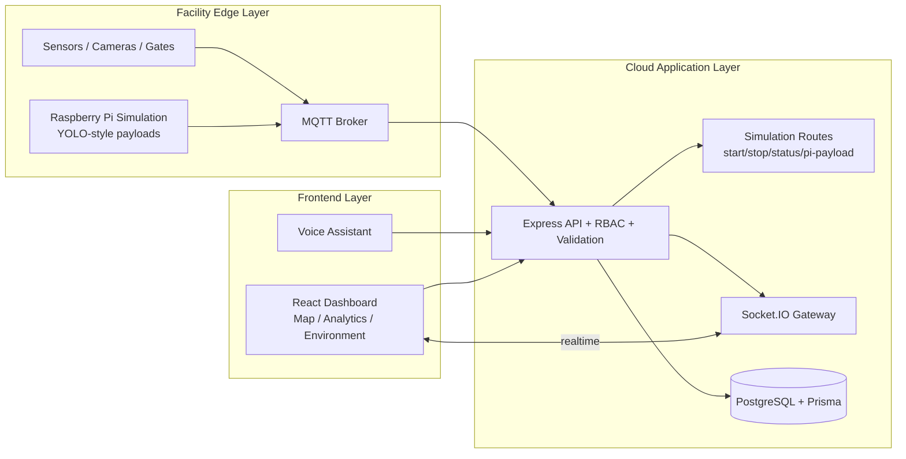
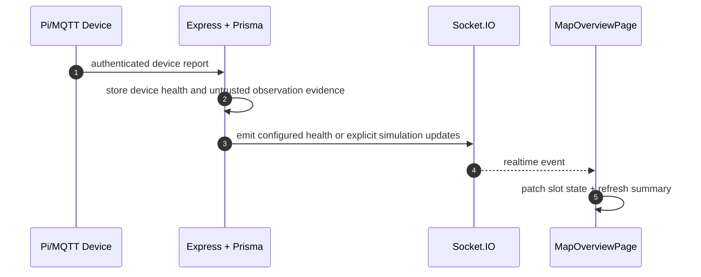

# BaySignal (formerly SmartPark AI)

Parking operations prototype for facility-scoped access, reservations, device health, and evidence-aware bay state. Reports without validated source data show as unavailable. Hardware gate/ANPR integration is not implemented.

## Live Demo Links

- Frontend: https://smartpark-client.onrender.com
- Backend API: https://smartpark-server.onrender.com
- Repository: https://github.com/goravgumber/SmartPark-AI

## Project Overview

BaySignal is a full-stack prototype for parking workflows:

- Live facility map with realtime slot updates
- Reservation lifecycle with atomic slot transitions
- Analytics and environmental reports remain unavailable until their source data and calculations are validated
- Voice answers for live facility data remain unavailable until tenant-scoped data sources are configured
- Explicit simulator for test/demo bay changes, recorded as simulation evidence

## Features

- Authentication and RBAC (DRIVER, OWNER, ADMIN)
- Realtime event pipeline (MQTT -> Backend -> Socket.IO -> Frontend)
- Reservation conflict protection and transaction-safe updates
- Alerts and device monitoring
- Tenant-scoped access with unassigned legacy facilities inaccessible by default

## AMD Technology Integration

SmartPark AI is mapped to AMD edge-to-cloud architecture:

- **AMD EPYC**: backend APIs, websocket fan-out, and analytics workloads
- **AMD Ryzen**: edge/facility node for on-site IoT ingestion and buffering
- **AMD Instinct + ROCm**: future inference plane for demand prediction
- **AMD Adaptive SoCs**: device-tier signal processing model

Detailed mapping: [docs/AMD_ARCHITECTURE.md](docs/AMD_ARCHITECTURE.md)

## Architecture Overview

### End-to-End System Flow



### Realtime Slot Update Pipeline



## Raspberry Pi Simulation

Simulation is controlled from the map page panel:

- Start/stop simulation interval (2s / 5s / 10s)
- Randomized slot transitions for selected facility
- Device payload ingestion route for synthetic edge messages
- Live counters (updates, slots changed, uptime)

API routes:

- `GET /api/simulation/status`
- `POST /api/simulation/start`
- `POST /api/simulation/stop`
- `POST /api/simulation/pi-payload`

## Tech Stack

- Backend: Node.js, Express.js, Prisma ORM
- Database: PostgreSQL (Render)
- Frontend: React, Vite, Tailwind CSS
- Realtime: Socket.IO
- IoT Simulation: MQTT (Mosquitto simulation)
- Security: JWT, RBAC, validation, rate limiting
- Deployment: Render (Web Service + Static Site + Managed Postgres)

## Local Setup

### 1. Clone

```bash
git clone https://github.com/goravgumber/SmartPark-AI.git
cd SmartPark-AI
```

### 2. Backend

```bash
cd server
cp .env.example .env
npm install
npx prisma generate
npx prisma db push # local development database only; verify DATABASE_URL before running
npm run db:seed # requires explicit local demo-seed opt-in and a locally supplied seed password
npm run dev
```

### 3. Frontend

```bash
cd ../client
npm install
npm run dev
```

Set `client/.env` for local frontend if needed:

```env
VITE_API_URL=http://localhost:4000/api
VITE_WS_URL=http://localhost:4000
```

## Deployment (Render)

`render.yaml` provisions:

- `smartpark-db` (PostgreSQL)
- `smartpark-server` (Node web service)
- `smartpark-client` (Static site)

Backend runtime requirements:

- `DATABASE_URL`
- `JWT_SECRET`
- `NODE_ENV=production`
- `FRONTEND_URL=https://smartpark-client.onrender.com`
- `DEVICE_API_KEY`

Frontend runtime requirements:

- `VITE_API_URL=https://smartpark-server.onrender.com/api`
- `VITE_WS_URL=https://smartpark-server.onrender.com`

## Demo Credentials

Demo passwords were removed from the repository. Configure credentials locally and rotate any previously disclosed demo account credentials before continued use.

## Hackathon Judge Flow

1. Sign in with an explicitly provisioned test account and open the facility map.
2. Use the simulator only in a configured test/demo environment; its changes are labeled as simulation.
3. Review reservation holds separately from recorded bay occupancy.
4. Open analytics and revenue reports to see their unavailable state while sources remain unvalidated.
5. Use the visit ledger only when verified gate evidence has been supplied by a trusted integration.
6. Review tenant access and the migration handoff before discussing operational deployment.

## Screenshots (Placeholders)

- `docs/screenshots/login.png`
- `docs/screenshots/map-overview.png`
- `docs/screenshots/analytics.png`
- `docs/screenshots/environment.png`
- `docs/screenshots/simulation-panel.png`

## Future Scope

- AI demand forecasting service on AMD Instinct + ROCm
- Dynamic pricing recommendation autopilot with review workflow
- Multi-facility tenancy and regional federation
- Redis-backed distributed websocket scaling and caching
- Observability stack (OpenTelemetry + traces + SLOs)
