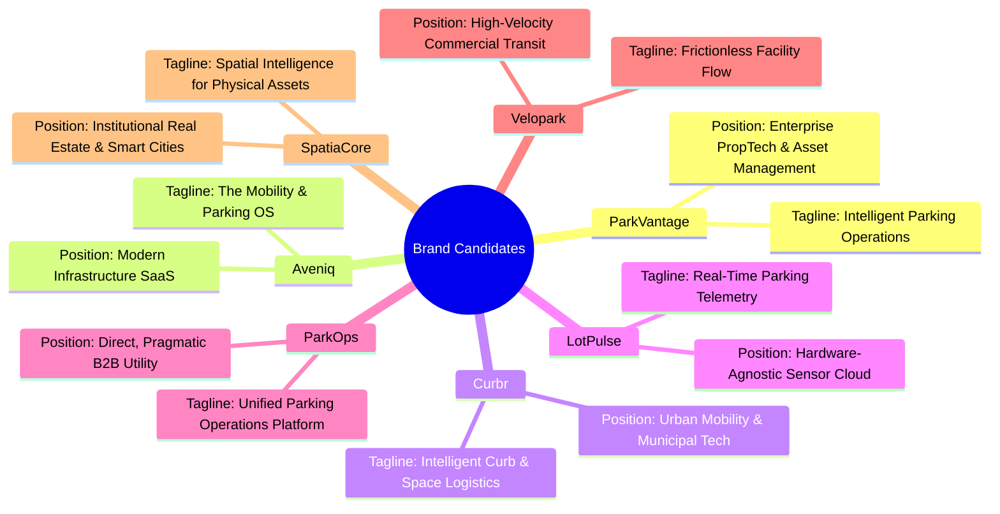

# SmartPark AI — Brand Identity & Commercial Name Options

> **Phase 1 Deliverable:** Strategic Brand Repositioning & Naming Exploration
> **Status:** Proposal for Executive Review
> **Target Sector:** Enterprise B2B Parking Operations, PropTech, Commercial Real Estate, Smart Mobility

---

## 1. Audit of Existing "SmartPark AI" References

Before rebranding the product, every visible and structural occurrence of the current name, abbreviations, logos, and demo credentials was audited across the repository:

### 1.1 Codebase Reference Inventory

| Category | File Location | Existing Reference | Replacement Impact |
| :--- | :--- | :--- | :--- |
| **README & Docs** | [`README.md`](file:///c:/Users/gorav/Desktop/projects/SmartPark-AI/README.md#L1) | `# SmartPark AI` | High (User-facing documentation) |
| **System Docs** | [`docs/SYSTEM_ARCHITECTURE.md`](file:///c:/Users/gorav/Desktop/projects/SmartPark-AI/docs/SYSTEM_ARCHITECTURE.md#L1) | `SmartPark AI — System Architecture` | High (Architecture documentation) |
| **AMD Docs** | [`docs/AMD_ARCHITECTURE.md`](file:///c:/Users/gorav/Desktop/projects/SmartPark-AI/docs/AMD_ARCHITECTURE.md#L1) | `AMD Architecture Alignment — SmartPark AI` | Medium (Strategic narrative) |
| **HTML Page Title**| [`client/index.html`](file:///c:/Users/gorav/Desktop/projects/SmartPark-AI/client/index.html#L6) | `<title>SmartPark AI — Intelligent Parking Platform</title>`| High (Browser tab title) |
| **Sidebar Brand** | [`client/src/components/layout/Sidebar.jsx`](file:///c:/Users/gorav/Desktop/projects/SmartPark-AI/client/src/components/layout/Sidebar.jsx#L63) | `
SmartPark

Mission Control
` | High (Primary UI masthead) |
| **Login Title** | [`client/src/pages/LoginPage.jsx`](file:///c:/Users/gorav/Desktop/projects/SmartPark-AI/client/src/pages/LoginPage.jsx#L72) | `<h1>SmartPark</h1>` | High (Authentication view) |
| **Voice Assistant**| [`client/src/components/voice/VoiceAssistant.jsx`](file:///c:/Users/gorav/Desktop/projects/SmartPark-AI/client/src/components/voice/VoiceAssistant.jsx#L251) | `SmartPark Voice AI` | Medium (Widget header) |
| **Simulation** | [`client/src/components/SimulationPanel.jsx`](file:///c:/Users/gorav/Desktop/projects/SmartPark-AI/client/src/components/SimulationPanel.jsx#L103) | `🥧 Raspberry Pi Simulator` | Medium (Simulation widget) |
| **Edge Script** | [`raspberry_pi/smartpark_agent.py`](file:///c:/Users/gorav/Desktop/projects/SmartPark-AI/raspberry_pi/smartpark_agent.py#L215) | `SmartPark AI Agent Starting...` | Medium (Console output) |
| **Server Startup** | [`server/src/index.js`](file:///c:/Users/gorav/Desktop/projects/SmartPark-AI/server/src/index.js#L136) | `SmartPark server listening on port...` | Low (Backend console log) |
| **Package Names** | `client/package.json`, `server/package.json` | `"smartpark-client"`, `"smartpark-server"` | High (NPM package identity) |
| **Cloud Config** | [`render.yaml`](file:///c:/Users/gorav/Desktop/projects/SmartPark-AI/render.yaml) | `smartpark-server`, `smartpark-client`, `smartpark-db` | High (Render service slugs) |
| **Storage Keys** | `client/src/store/auth.js` | `smartpark_token`, `smartpark_user` | High (Browser LocalStorage keys) |
| **Demo Accounts** | `server/prisma/seed.js`, `README.md` | `admin@smartpark.ai`, `owner@smartpark.ai`, `driver@smartpark.ai` | High (Demo user emails) |
| **Code Prefixes** | `server/src/routes/reservations.js` | `SPK-XXXX` reservation code generator | Medium (Ticket serial numbering) |

---

## 2. Positioning Critique: Why Retitle "SmartPark AI"?

1. **Generic "AI" Suffix Fatigue:** The label "SmartPark AI" sounds like a 48-hour student hackathon project. In enterprise enterprise procurement (malls, airports, municipal transit authorities), slapping "AI" onto basic CRUD dashboards reduces credibility because decision-makers expect genuine neural inference, not simple keyword matching or mathematical curves.
2. **Commoditized "SmartPark" Prefix:** "SmartPark" is one of the most overused trademarks in the global parking and IoT sectors, with dozens of existing regional companies, apps, and hardware vendors using identical or confusingly similar variations.
3. **Product Vision Expansion:** The platform is evolving from a single parking lot simulation into an **integrated urban mobility & parking operations operating system** covering reservations, dynamic pricing, hardware telemetry, and ESG compliance.

---

## 3. Alternative Commercial Brand Candidates

Below are 7 distinct, professionally crafted brand identity options designed for enterprise credibility, international scalability, and modern SaaS positioning.

---

### Candidate 1: ParkVantage
- **Pronunciation:** `/ˈpɑːrkˌvæn.tɪdʒ/`
- **Tagline:** *Intelligent Parking Operations & Asset Intelligence*
- **Positioning Rationale:** Combines "Park" (immediate category clarity) with "Vantage" (superior visibility, operational vantage point, and financial advantage). It sounds established, premium, and institutional. Highly resonant with commercial real estate owners, mall operators, and airport authorities.
- **Tone & Enterprise Fit:** Authoritative, executive, dependable. Fits alongside brands like Procore, AppFolio, and CoStar.
- **Visual & Stitch Design Cues:** Deep corporate navy (`#0F172A`) paired with precision cobalt blue (`#2563EB`) and sharp geometric accents. Evokes an elevated control tower perspective.
- **Reservation Code Prefix:** `PV-XXXX` (e.g. `PV-1082`)

---

### Candidate 2: Aveniq
- **Pronunciation:** `/ˈæv.ə.niːk/` (Blend of *Avenue* + *Intelligence*)
- **Tagline:** *The Urban Mobility & Parking Operating System*
- **Positioning Rationale:** Distinctive, abstract tech name that avoids the word "Park" entirely, allowing the platform to expand seamlessly into EV charging hubs, curbside pickup logistics, tolling, and autonomous fleet dispatching without rebranding.
- **Tone & Enterprise Fit:** Modern, sleek, VC-backed SaaS. Appeals to modern smart city planners, tech-forward real estate developers, and municipal innovation funds.
- **Visual & Stitch Design Cues:** Clean architectural slate (`#0B132B`) with vibrant electric cyan (`#06B6D4`) and energetic emerald (`#10B981`). Minimalist typography, high-density layouts.
- **Reservation Code Prefix:** `AVQ-XXXX` (e.g. `AVQ-4910`)

---

### Candidate 3: Curbr (or CurbR)
- **Pronunciation:** `/ˈkɜːr.bər/`
- **Tagline:** *Intelligent Curb & Spatial Logistics*
- **Positioning Rationale:** Aligns with the massive urban trend of "Curb Management." In dense cities, parking is no longer just stationary storage—it is dynamic curb and bay allocation for deliveries, ride-shares, EVs, and drivers. "Curbr" positions the product at the bleeding edge of municipal urban tech.
- **Tone & Enterprise Fit:** Agile, modern, infrastructure-focused. Resonates with city transportation departments and multi-modal transit hubs.
- **Visual & Stitch Design Cues:** High-contrast asphalt grey (`#18181B`) with high-visibility safety amber (`#F59E0B`) and crisp white. Street-level precision and logistics feel.
- **Reservation Code Prefix:** `CBR-XXXX` (e.g. `CBR-8821`)

---

### Candidate 4: LotPulse
- **Pronunciation:** `/ˈlɒtˌpʌls/`
- **Tagline:** *Real-Time Facility Telemetry & Automated Dispatch*
- **Positioning Rationale:** Focuses squarely on the application's strongest technical capability: real-time live telemetry, sub-second slot updates, and IoT edge connectivity. "Pulse" immediately communicates live heartbeat data and operational vitality.
- **Tone & Enterprise Fit:** Highly technical, fast, responsive. Favored by parking operators who manage high-turnover lots and require live hardware monitoring.
- **Visual & Stitch Design Cues:** Dark neutral canvas with dynamic pulse indicators, clean data tables, live telemetry graphs, and status chips.
- **Reservation Code Prefix:** `LP-XXXX` (e.g. `LP-3490`)

---

### Candidate 5: ParkOps
- **Pronunciation:** `/ˈpɑːrk.ɒps/`
- **Tagline:** *The Unified Parking Operations Platform*
- **Positioning Rationale:** Follows the proven B2B naming convention of developer and operations tools (DevOps, RevOps, SysOps). Tells enterprise buyers exactly what the product does with zero ambiguity: it is the operational cockpit for their facilities.
- **Tone & Enterprise Fit:** Practical, straightforward, mission-critical. Appeals to operations directors and facility engineers who dislike marketing fluff.
- **Visual & Stitch Design Cues:** Utilitarian, clean typography, compact data rhythms, clear status indicators. Like a high-performance terminal dressed in a modern Stripe-like UI.
- **Reservation Code Prefix:** `PO-XXXX` (e.g. `PO-7714`)

---

### Candidate 6: Velopark
- **Pronunciation:** `/ˈvɛl.oʊˌpɑːrk/` (From *Velocity* + *Parking*)
- **Tagline:** *Frictionless Facility Access & Intelligent Flow*
- **Positioning Rationale:** Emphasizes speed, throughput, and eliminating driver congestion. The core promise is that drivers find and book parking rapidly, while operators maximize turnover velocity.
- **Tone & Enterprise Fit:** Consumer-friendly yet commercially serious. Bridges the gap between driver-facing mobile booking and operator fleet management.
- **Visual & Stitch Design Cues:** Dynamic angled accents, emerald green efficiency markers, fast-rendering responsive components.
- **Reservation Code Prefix:** `VPK-XXXX` (e.g. `VPK-2301`)

---

### Candidate 7: SpatiaCore
- **Pronunciation:** `/ˈspeɪ.ʃəˌkɔːr/`
- **Tagline:** *Spatial Intelligence for Physical Infrastructure*
- **Positioning Rationale:** Positions the platform as a spatial computing and asset optimization engine. Frames parking bays as valuable spatial real estate assets that generate yield, support EV transition, and reduce carbon footprints.
- **Tone & Enterprise Fit:** Institutional, data-centric, scientific. High appeal for institutional REITs, smart city consortiums, and infrastructure funds.
- **Visual & Stitch Design Cues:** Cool zinc backgrounds (`#27272A`), deep royal indigo (`#4338CA`), precise data charts, and spatial zone heatmaps.
- **Reservation Code Prefix:** `SPC-XXXX` (e.g. `SPC-9011`)

---

## 4. Brand Comparative Evaluation Matrix

| Criterion (Weight) | ParkVantage | Aveniq | Curbr | LotPulse | ParkOps | Velopark | SpatiaCore |
| :--- | :---: | :---: | :---: | :---: | :---: | :---: | :---: |
| **Enterprise Credibility (25%)** | 9.5 | 8.5 | 8.0 | 8.0 | 9.0 | 7.5 | 9.0 |
| **Category Clarity (20%)** | 9.5 | 6.5 | 8.0 | 9.0 | 10.0 | 9.5 | 6.0 |
| **Tech Scalability (20%)** | 8.0 | 10.0 | 9.5 | 8.5 | 8.0 | 8.0 | 9.5 |
| **Pronounceability / Memorability (15%)**| 9.0 | 8.5 | 9.0 | 9.5 | 9.0 | 8.5 | 7.5 |
| **Avoids Hackathon AI Cliches (10%)** | 10.0 | 10.0 | 10.0 | 10.0 | 10.0 | 10.0 | 10.0 |
| **Driver & B2B Dual Appeal (10%)** | 8.5 | 8.0 | 8.5 | 7.5 | 7.0 | 9.5 | 6.5 |
| **Weighted Score (100%)** | **9.05** | **8.50** | **8.55** | **8.55** | **8.85** | **8.55** | **8.05** |

---

## 5. Naming Decision Checklist & Clear Next Steps

### 5.1 Verification Caveat

> [!WARNING]
> **Trademark & Domain Availability Notice:**
> The name candidates above have been evaluated for linguistic, strategic, and positioning fit based solely on repository discovery. No formal trademark searches (USPTO, WIPO, or regional registries) or domain registrations (`.com`, `.io`, `.co`) have been performed. Final selection requires independent clearance before rebranding public repositories, package namespaces, or legal entities.

### 5.2 Recommended Decision Flow

1. **Step 1:** Executive selection of top 2 preferred naming candidates from the 7 options (Recommended shortlist: **ParkVantage** for institutional enterprise appeal, or **ParkOps** for direct operational clarity).
2. **Step 2:** Run Google Stitch design explorations using the selected candidate name in the application masthead, login screen, and gate pass tickets.
3. **Step 3:** Perform trademark, GitHub organization, and domain clearance for the preferred name.
4. **Step 4 (Phase 2):** Implement the formal rename across `package.json`, `render.yaml`, environment variables, seed scripts, and documentation files in a single coordinated refactor.
