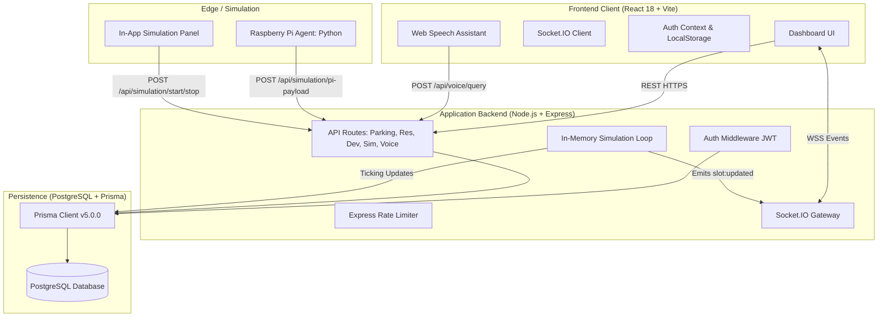
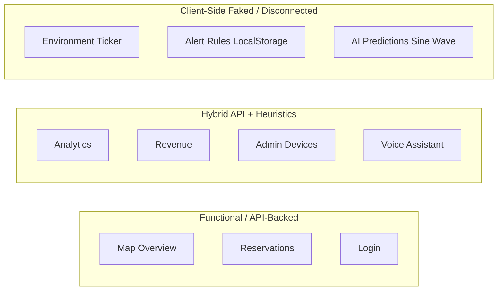
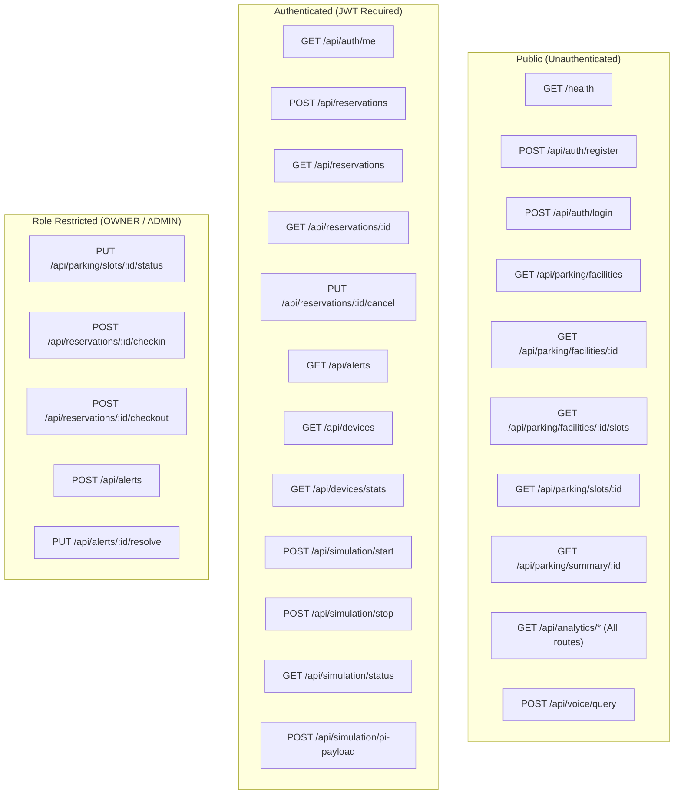
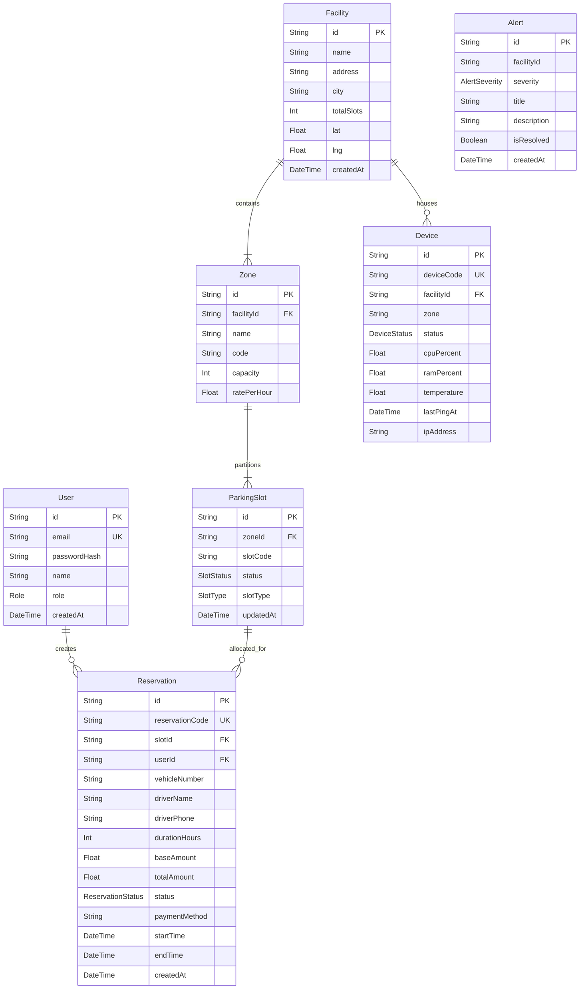
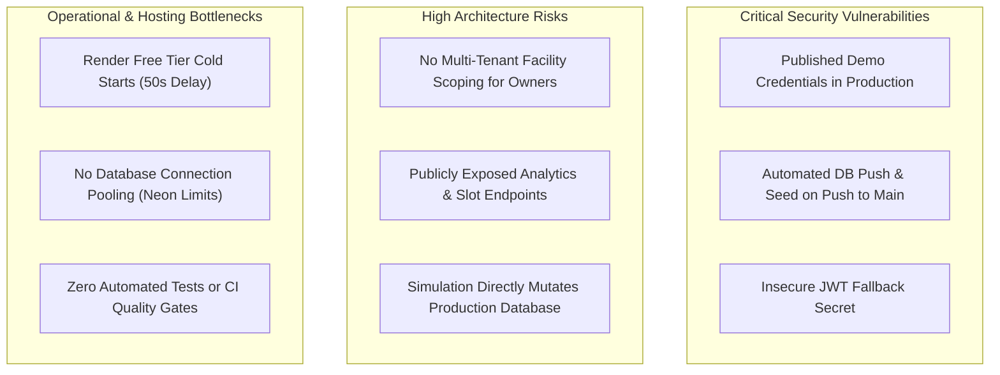

# SmartPark AI — Product Discovery & Architecture Audit

> **Phase 1 Technical Discovery Report**
> **Repository:** `goravgumber/SmartPark-AI`
> **Working Branch:** `docs/smartpark-product-discovery`
> **Commit Baseline:** `d7e2e13` (*refactor: redesign UI to minimalist light theme*)
> **Audit Date:** October 2026
> **Classification:** Comprehensive Technical Discovery & Readiness Audit

---

## 1. Executive Summary & Repository Baseline

SmartPark AI was originally developed as an end-to-end hackathon prototype demonstrating an intelligent parking operations platform. It combines a React dashboard, an Express.js REST API with Socket.IO realtime event streaming, a PostgreSQL database managed via Prisma ORM, and an edge device simulation agent (`smartpark_agent.py`) simulating a Raspberry Pi.

This audit establishes the ground truth of the repository as of commit [`d7e2e13`](file:///c:/Users/gorav/Desktop/projects/SmartPark-AI): what works, what is simulated, what is missing, and what critical blockers prevent enterprise or commercial deployment.



### 1.1 Repository Baseline Metrics

| Metric | Inspected Value | Evidence / Source |
| :--- | :--- | :--- |
| **Active Branch** | `docs/smartpark-product-discovery` | Branched from `origin/main` (`d7e2e13`) |
| **Commit History** | 15+ commits; latest commit `d7e2e13` | [`git log`](file:///c:/Users/gorav/Desktop/projects/SmartPark-AI) |
| **Release Tags** | `v0.1.0`, `v0.2.0`, `v0.3.0`, `v0.4.0`, `v0.5.0`, `v1.0.0`, `v1.1.0` | [`git tag -l`](file:///c:/Users/gorav/Desktop/projects/SmartPark-AI) |
| **Working Tree** | Clean; zero uncommitted modifications before documentation branch | `git status` |
| **Node.js Runtime** | Node v24.22.0, npm v11.19.1 | System environment |
| **Backend Dependencies** | 12 dependencies (`@prisma/client`, `express`, `socket.io`, `zod`, `bcryptjs`, `jsonwebtoken`, `pg`, `helmet`, `cors`, etc.) | [`server/package.json`](file:///c:/Users/gorav/Desktop/projects/SmartPark-AI/server/package.json) |
| **Frontend Dependencies** | 8 dependencies (`react`, `react-dom`, `react-router-dom`, `axios`, `socket.io-client`, `recharts`, `lucide-react`, `clsx`) | [`client/package.json`](file:///c:/Users/gorav/Desktop/projects/SmartPark-AI/client/package.json) |
| **Backend Syntax Check** | 100% PASS (17/17 `.js` files validated via `node -c`) | Verified local inspection |
| **Automated Test Coverage** | **0%** — No test scripts or test files exist in either client or server | `package.json` inspection |
| **Linter Configuration** | **None** — No ESLint, Prettier, or TypeScript configurations exist | Repo root inspection |
| **Deployment Blueprint** | Render Blueprint (`render.yaml`): Node Web Service + Static Site + Managed Postgres | [`render.yaml`](file:///c:/Users/gorav/Desktop/projects/SmartPark-AI/render.yaml) |
| **CI/CD Workflows** | 1 workflow: `.github/workflows/db-setup.yml` (pushes Prisma schema & runs seed on push to main) | [`.github/workflows/db-setup.yml`](file:///c:/Users/gorav/Desktop/projects/SmartPark-AI/.github/workflows/db-setup.yml) |

---

## 2. Complete Frontend Architecture Audit

The client application is built with React 18.3, Vite 5.2, React Router 6.23, and Tailwind CSS 3.4.

### 2.1 Router & Navigation Hierarchy

The application routing is defined in [`client/src/App.jsx`](file:///c:/Users/gorav/Desktop/projects/SmartPark-AI/client/src/App.jsx#L52-L72):

```
/ (Root)
├── /login ── LoginPage (Public)
└── /dashboard ── ProtectedRoute + AppShell (Requires token in localStorage)
    ├── /dashboard/map ── MapOverviewPage (Default redirect from /dashboard)
    ├── /dashboard/analytics ── AnalyticsPage
    ├── /dashboard/environment ── EnvironmentPage
    ├── /dashboard/reservations ── ReservationsPage
    ├── /dashboard/revenue ── RevenuePage
    ├── /dashboard/alerts ── AlertsPage
    ├── /dashboard/ai ── AIPredictionsPage
    └── /dashboard/admin ── AdminPage
```

#### Router & Auth Guard Deficiencies:
1. **No Role-Based Route Guards:** [`ProtectedRoute`](file:///c:/Users/gorav/Desktop/projects/SmartPark-AI/client/src/App.jsx#L16-L33) checks only whether `localStorage.getItem('smartpark_token')` is non-empty. Any user logged in as a `DRIVER` can manually navigate to `/dashboard/admin`, `/dashboard/revenue`, `/dashboard/alerts`, and `/dashboard/ai`.
2. **Universal Landing Screen:** Regardless of whether the user is an `ADMIN`, `OWNER`, or `DRIVER`, successful login in [`LoginPage.jsx`](file:///c:/Users/gorav/Desktop/projects/SmartPark-AI/client/src/pages/LoginPage.jsx#L61) unconditionally redirects to `/dashboard/map`.
3. **No Dynamic Navigation Filtering:** In [`client/src/components/layout/Sidebar.jsx`](file:///c:/Users/gorav/Desktop/projects/SmartPark-AI/client/src/components/layout/Sidebar.jsx#L15-L24), all 8 navigation tabs are rendered identically for every role.

---

### 2.2 Screen-by-Screen Deep Dive



#### 1. Login Page (`/login`)
- **File Reference:** [`client/src/pages/LoginPage.jsx`](file:///c:/Users/gorav/Desktop/projects/SmartPark-AI/client/src/pages/LoginPage.jsx)
- **Business Purpose:** Authenticate drivers, facility operators, and administrators.
- **Displayed Data:** Email and password fields, remember-me checkbox, submit button.
- **Data Sources & API:** `POST /api/auth/login` via [`client/src/store/auth.js`](file:///c:/Users/gorav/Desktop/projects/SmartPark-AI/client/src/store/auth.js#L56).
- **Hardcoded & Simulated Elements:**
  - Has an artificial 800ms loading delay (`new Promise(resolve => setTimeout(resolve, 800))`).
  - Contains an unused `roles` catalog in code (`DRIVER`, `OWNER`, `ADMIN`, `ANALYST`) that is never rendered in the UI.
  - Inputs default pre-filled to `driver@smartpark.ai` and `Admin@123`.
  - "Forgot?" password link is a dead anchor (`href="#"`).

#### 2. Map Overview Page (`/dashboard/map`)
- **File Reference:** [`client/src/pages/MapOverviewPage.jsx`](file:///c:/Users/gorav/Desktop/projects/SmartPark-AI/client/src/pages/MapOverviewPage.jsx)
- **Business Purpose:** Central mission control displaying real-time slot occupancy across zones, enabling on-demand slot reservations.
- **Displayed Data:**
  - 4 KPI cards: Total Slots, Available, Occupied, Reserved.
  - Zone filters: `ALL`, `Zone A`, `Zone B`, `Zone C`, `VIP`, `Handicap`.
  - Status filters: `ALL`, `Available`, `Occupied`, `Reserved`.
  - Grid of slot tiles (120 slots total) color-coded by status with visual car/reserved icons.
  - Floating Raspberry Pi Simulation panel.
- **Data Sources & API:**
  - `GET /api/parking/facilities` (loads facilities, defaults to `facilities[0]`).
  - `GET /api/parking/facilities/:id/slots` (loads slots list).
  - `GET /api/parking/summary/:id` (loads summary counts, polled every 5s if auto-refresh is on).
  - `POST /api/reservations` (when booking an available slot).
- **Socket.IO Subscriptions:**
  - Room: `join:facility` for selected facility.
  - Event: `slot:updated` triggers localized slot re-rendering with a 340ms highlight animation (`slot-flash`).
- **Simulated / Fake Elements:**
  - When a reservation is completed, the modal displays `fakeQrGrid()`, which generates a grid of 36 random black/white boxes masquerading as a QR code!
  - Confetti particle animation is hardcoded DOM elements.
  - Floor is hardcoded text: "Floor G".

#### 3. Analytics Page (`/dashboard/analytics`)
- **File Reference:** [`client/src/pages/AnalyticsPage.jsx`](file:///c:/Users/gorav/Desktop/projects/SmartPark-AI/client/src/pages/AnalyticsPage.jsx)
- **Business Purpose:** Provide facility managers with historical utilization metrics, hourly trends, zone performance, and revenue summaries.
- **Displayed Data:** Occupancy rate circular progress ring, time saved, daily revenue, transactions count, 24-hour occupancy trend chart, slot status distribution pie chart, weekly revenue bar chart, radar zone comparison chart, AI insights panel, top slots data table.
- **Data Sources & API:**
  - `GET /api/analytics/dashboard/:facilityId`
  - `GET /api/analytics/occupancy/:facilityId`
  - `GET /api/analytics/revenue/:facilityId`
  - `GET /api/analytics/top-slots/:facilityId`
  - `GET /api/parking/facilities/:facilityId`
- **Hardcoded & Simulated Elements:**
  - **The 24-hour occupancy curve is 100% synthetic math:** Backend `occupancy` endpoint uses a Gaussian mathematical formula around 19:00 peak rather than historical database aggregation.
  - **AI Insights Panel is 100% static mock HTML:** Hardcoded strings ("Zone B peaks at 6-8 PM", "Slots A-01 to A-10 at 95%", "AI Confidence: 84%").
  - **Radar chart yesterday data is simulated:** `yesterday = Math.round(today * 0.85)`.
  - Reserved slots in trend chart are synthetic: `reserved = item.reserved ?? Math.max(1, Math.round(item.occupied * 0.18))`.

#### 4. Environment Page (`/dashboard/environment`)
- **File Reference:** [`client/src/pages/EnvironmentPage.jsx`](file:///c:/Users/gorav/Desktop/projects/SmartPark-AI/client/src/pages/EnvironmentPage.jsx)
- **Business Purpose:** Quantify urban ESG impact (fuel saved, COâ‚‚ reduced, search time saved).
- **Displayed Data:** 4 primary counters (Fuel Saved, COâ‚‚ Reduced, Time Saved, Cars Guided), equivalence formulas, 30-day monthly trend chart, Environmental Score ring (87/100).
- **Data Sources & API:** Initial fetch from `GET /api/analytics/environmental/:facilityId`.
- **Hardcoded & Simulated Elements:**
  - **Artificial Realtime Ticker:** Runs `setInterval` every 3,000ms incrementing fuel by 0.1L, COâ‚‚ by 0.23kg, and time by 0.05 hrs to fabricate realtime activity!
  - **Car Counter Ticker:** Increments `carsGuided` every 30,000ms on the client.
  - **30-Day Trend Data:** Generated client-side via `Math.random()` (`makeTrendData()`).
  - **Generate Impact Report Button:** Does not export or download anything; triggers two dummy timeout toasts.

#### 5. Reservations Page (`/dashboard/reservations`)
- **File Reference:** [`client/src/pages/ReservationsPage.jsx`](file:///c:/Users/gorav/Desktop/projects/SmartPark-AI/client/src/pages/ReservationsPage.jsx)
- **Business Purpose:** Central reservation registry for drivers and operators to inspect, filter, check-in, check-out, and cancel reservations.
- **Displayed Data:** Summary counter cards, status filter tabs (`ALL`, `UPCOMING`, `ACTIVE`, `COMPLETED`, `CANCELLED`), paginated table, slide-down reservation details panel.
- **Data Sources & API:**
  - `GET /api/reservations?status=...&page=...&limit=...`
  - `PUT /api/reservations/:id/cancel`
  - `POST /api/reservations/:id/checkin` (Owner/Admin only)
  - `POST /api/reservations/:id/checkout` (Owner/Admin only)
- **Status:** **Verified Implemented.** This is the cleanest, most functionally complete CRUD workflow in the entire project.

#### 6. Revenue Page (`/dashboard/revenue`)
- **File Reference:** [`client/src/pages/RevenuePage.jsx`](file:///c:/Users/gorav/Desktop/projects/SmartPark-AI/client/src/pages/RevenuePage.jsx)
- **Business Purpose:** Financial tracking, settlement metrics, and dynamic pricing management.
- **Displayed Data:** KPI cards (Today, Week, Month, Avg/Slot, Pending Settlement), 30-day composed bar/line trend chart, revenue by zone bar chart, payment method pie chart, 7x24 revenue heatmap, AI Dynamic Pricing recommendation engine.
- **Data Sources & API:** `GET /api/analytics/dashboard/:id` and `GET /api/analytics/revenue/:id`.
- **Hardcoded & Simulated Elements:**
  - 30-day historical revenue chart generated client-side via `Math.random()` (`makeRevenue30Days()`).
  - 7x24 heatmap data is generated with `Math.random()` (`makeHeatmapData()`).
  - Payment method breakdown is hardcoded (UPI 58%, Card 22%, Cash 8%, Other 12%).
  - Revenue by zone is hardcoded (`Zone A: 128000`, etc.).
  - "AI Dynamic Pricing Engine" suggestions are static hardcoded items; clicking "Apply" or "Apply All" only fires toast notifications without mutating any rates.

#### 7. Alerts Page (`/dashboard/alerts`)
- **File Reference:** [`client/src/pages/AlertsPage.jsx`](file:///c:/Users/gorav/Desktop/projects/SmartPark-AI/client/src/pages/AlertsPage.jsx)
- **Business Purpose:** Operational alerts center.
- **Current Implementation Reality:**
  - **Severe Functional Disconnect:** The backend has a database model `Alert` and working endpoints `GET /api/alerts`, `POST /api/alerts`, and `PUT /api/alerts/:id/resolve`. **The frontend page does not call ANY of these endpoints.**
  - Instead, the page renders dummy toggles for Email (SendGrid), Push, Slack, and SMS (Twilio), storing toggles in `localStorage`.
  - Alert rules (occupancy threshold, offline timeout) are stored only in `localStorage`.
  - None of the 8 seeded operational alerts in the database can be seen or resolved on this screen!

#### 8. AI Predictions Page (`/dashboard/ai`)
- **File Reference:** [`client/src/pages/AIPredictionsPage.jsx`](file:///c:/Users/gorav/Desktop/projects/SmartPark-AI/client/src/pages/AIPredictionsPage.jsx)
- **Business Purpose:** Machine learning demand forecasting and automated slot recommendation.
- **Current Implementation Reality:**
  - **100% Client-Side Simulation.** Zero backend API integration.
  - The 48-hour occupancy curve is generated with a trigonometric function: `Math.sin(i / 4) * 14`.
  - Model health table (Version v2.8.4, Accuracy 87.3%) and historical error rates are static HTML.
  - "Accept Recommendation" buttons only trigger a success toast.

#### 9. Admin Panel (`/dashboard/admin`)
- **File Reference:** [`client/src/pages/AdminPage.jsx`](file:///c:/Users/gorav/Desktop/projects/SmartPark-AI/client/src/pages/AdminPage.jsx)
- **Business Purpose:** Edge device management, facility configuration, user management, and system telemetry.
- **Current Implementation Reality:**
  - `Devices` tab: Successfully queries `GET /api/devices` and displays registered edge devices. Clicking "Inspect" renders hardcoded mock logs. "Add Device" modal does not submit an API call.
  - `Parking Config` tab: Renders raw text: `"Parking Config module placeholder"`.
  - `Users` tab: Renders raw text: `"Users module placeholder"`.
  - `System Health` tab: Randomly jitters latency and fakes service uptime for Redis, MQTT, WebSocket, and REST API.
  - `Settings` tab: Static form; "Save Settings" only triggers a toast.

---

### 2.3 Screen-by-Screen Feature Matrix

| Route | Feature | Documented Capability | Actual Implementation Status | Evidence / Notes |
| :--- | :--- | :--- | :--- | :--- |
| `/login` | Authentication | Multi-role login | **Verified Implemented** | Uses JWT, queries Postgres via Prisma |
| `/login` | Quick Role Switcher | Click to switch role | **Broken / Dead Code** | Role array exists in source, never rendered |
| `/dashboard/map` | Slot Grid | Realtime slot status | **Verified Implemented** | 120 slots loaded from DB, patched via Socket.IO |
| `/dashboard/map` | Slot Booking | Reserve available slot | **Verified Implemented** | Atomic serializable transaction with conflict checks |
| `/dashboard/map` | QR Code Generation | Driver entry QR code | **Simulated** | 36 random black/white divs masquerading as QR |
| `/dashboard/map` | Facility Switcher | Multi-facility browsing | **Broken / Hardcoded** | Hardcoded to `facilities[0]`; header button is non-functional |
| `/dashboard/analytics` | Occupancy KPI | Live occupancy rate | **Verified Implemented** | Calculated from current DB slot counts |
| `/dashboard/analytics` | 24h Trend Chart | Historical hourly curve | **Simulated** | Mathematical Gaussian curve, no historical tables |
| `/dashboard/analytics` | AI Insights Panel | Anomaly & demand tips | **Hardcoded** | Static text strings, no inference engine |
| `/dashboard/environment` | ESG Counters | Fuel/COâ‚‚ savings | **Partially Implemented** | Base formula based on DB count, then client tickers fake increments |
| `/dashboard/environment` | Monthly ESG Trend | 30-day environmental chart | **Simulated** | `Math.random()` generated in client memory |
| `/dashboard/reservations` | Reservation List | Filter & paginate bookings | **Verified Implemented** | Paginated DB query with driver role isolation |
| `/dashboard/reservations` | Check-in / Check-out | Operator gate controls | **Verified Implemented** | Atomic slot state transitions via backend API |
| `/dashboard/revenue` | Today/Week Revenue | Financial aggregations | **Verified Implemented** | Summed from completed reservations in Postgres |
| `/dashboard/revenue` | 30-Day Trend & Heatmap | Daily & hourly revenue | **Simulated** | Client-generated synthetic arrays |
| `/dashboard/revenue` | AI Dynamic Pricing | Auto-adjust rates | **Simulated** | Hardcoded cards; buttons only show UI toasts |
| `/dashboard/alerts` | Alert Feed & Resolution | Manage active incidents | **Broken / Not Connected**| Backend `/api/alerts` exists; frontend screen ignores it |
| `/dashboard/alerts` | Notification Rules | SendGrid / Twilio channels | **Hardcoded / Simulated** | Saved strictly to client `localStorage` |
| `/dashboard/ai` | 48h Occupancy Forecast | Predictive demand curve | **Simulated** | Sine-wave generator (`Math.sin`); no backend route |
| `/dashboard/admin` | Device Health Grid | Monitor edge devices | **Verified Implemented** | Fetches `Device` rows from PostgreSQL |
| `/dashboard/admin` | Parking & User Config | CRUD zones & accounts | **Broken / Incomplete** | Shows literal "placeholder" text |
| Global Voice | Bilingual Assistant | Hindi/English voice control | **Partially Implemented** | Keyword matcher on backend + Web Speech API |

---

### 2.4 Visual System & CSS Audit

In commit [`d7e2e13`](file:///c:/Users/gorav/Desktop/projects/SmartPark-AI), the frontend underwent an uncoordinated refactor from a dark sci-fi theme (`#050B18`) to a minimalist light theme (`#f7fafc`).

#### Critical Styling & Contrast Flaws Identified:
1. **Aggressive `!important` Class Hijacking:** In [`client/src/index.css`](file:///c:/Users/gorav/Desktop/projects/SmartPark-AI/client/src/index.css#L99-L135), the original dark Tailwind utility classes were forced into light mode equivalents using `!important`:
   ```css
   .bg-dark-base { background: var(--sp-bg) !important; }
   .bg-dark-surface { background: var(--sp-card) !important; }
   .text-white { color: var(--sp-text) !important; } /* CRITICAL BUG */
   ```
2. **Text Invisibility Bug:** Because `.text-white` was mapped to `var(--sp-text)` (`#0f172a`), any intentionally dark button (e.g. gradient headers, badges, or primary buttons) that applies `text-white` ends up with dark charcoal text on dark backgrounds or dark text on dark badges, rendering text completely unreadable!
3. **Fragmented Color Identity:** The codebase mixes two conflicting design languages:
   - *Legacy Sci-Fi Cyberpunk:* Font `Orbitron`, neon cyan (`#00E5FF`), neon green (`#00FF88`), amber (`#FFB300`), violet (`#7B61FF`), glow filters (`glow-cyan`).
   - *Minimalist Enterprise Light:* Font `Inter`, Slate (`#0f172a`), Corporate Blue (`#2b6cb0`), neutral borders (`#e6eef7`).
4. **Header Layout Hardcoding:** The global header in [`client/src/components/layout/Header.jsx`](file:///c:/Users/gorav/Desktop/projects/SmartPark-AI/client/src/components/layout/Header.jsx#L173) has a fixed left offset `md:left-[260px]`, while the sidebar has width `w-64` (256px), creating a 4px misalignment gap on desktop screens.

---

## 3. Backend & Business Logic Audit

The server application is built with Node.js, Express 4.18, Prisma 5.0.0, and Socket.IO 4.7.4.

### 3.1 Complete API Catalog



| Method | Path | Auth Required | Role Required | Request Validation | Key Operations & Events |
| :--- | :--- | :--- | :--- | :--- | :--- |
| `GET` | `/health` | No | Any | None | Returns uptime, server status |
| `POST` | `/api/auth/register` | No | Any | Zod (`name`, `email`, `password`) | Hashes password via bcrypt (10 rounds), defaults role to `DRIVER` |
| `POST` | `/api/auth/login` | No | Any | Zod (`email`, `password`) | Verifies password hash, issues JWT token |
| `GET` | `/api/auth/me` | Yes | Any | None | Returns authenticated user profile |
| `GET` | `/api/parking/facilities` | No | Any | None | Lists facilities with aggregated slot counts |
| `GET` | `/api/parking/facilities/:id`| No | Any | None | Detailed facility zones and capacities |
| `GET` | `/api/parking/facilities/:id/slots` | No | Any | Zod query (`zone`, `status`) | Lists all slots for facility |
| `GET` | `/api/parking/slots/:id` | No | Any | None | Slot details and parent facility |
| `PUT` | `/api/parking/slots/:id/status` | Yes | `OWNER`, `ADMIN` | Zod (`status`) | Validates transition rules; emits `slot:updated` to facility room |
| `GET` | `/api/parking/summary/:facilityId` | No | Any | None | Slot counts cached in-memory (30s TTL) |
| `POST` | `/api/reservations` | Yes | Any | Zod schema | Serializable transaction; sets slot to `RESERVED`; emits `slot:updated` |
| `GET` | `/api/reservations` | Yes | Any | Zod query (`status`, `page`, `limit`) | Paginated. If `DRIVER`, scoped to `userId`; if Owner/Admin, all records |
| `GET` | `/api/reservations/:id` | Yes | Any | None | Driver forbidden if not creator; Owner/Admin allowed |
| `PUT` | `/api/reservations/:id/cancel`| Yes | Any | None | Only `UPCOMING` allowed; resets slot to `AVAILABLE`; emits `slot:updated` |
| `POST` | `/api/reservations/:id/checkin`| Yes | `OWNER`, `ADMIN` | None | Updates reservation to `ACTIVE`, slot to `OCCUPIED`; emits `slot:updated` |
| `POST` | `/api/reservations/:id/checkout`| Yes | `OWNER`, `ADMIN` | None | Updates reservation to `COMPLETED`, slot to `AVAILABLE`; emits `slot:updated` |
| `GET` | `/api/analytics/occupancy/:id` | No | Any | None | Returns 24h mathematical Gaussian occupancy distribution |
| `GET` | `/api/analytics/revenue/:id` | No | Any | None | Last 7 days revenue from DB; fallback to synthetic amounts if missing |
| `GET` | `/api/analytics/environmental/:id` | No | Any | None | Derives metrics from completed reservations count |
| `GET` | `/api/analytics/top-slots/:id`| No | Any | None | Groups reservations by `slotId` to find top 10 utilized slots |
| `GET` | `/api/analytics/dashboard/:id`| No | Any | None | Aggregated summary bundle for main dashboard |
| `GET` | `/api/alerts` | Yes | Any | Zod query (`facilityId`, `severity`, `resolved`) | Lists alert records |
| `POST` | `/api/alerts` | Yes | `OWNER`, `ADMIN` | Zod schema | Inserts alert into DB; emits `alert:new` to facility room |
| `PUT` | `/api/alerts/:id/resolve` | Yes | `OWNER`, `ADMIN` | None | Sets `isResolved = true`; emits `alert:resolved` |
| `GET` | `/api/devices` | Yes | Any | Zod query (`facilityId`) | Lists registered edge devices |
| `PUT` | `/api/devices/:id/heartbeat` | API Key | Any | Zod schema | Updates telemetry. Generates warning alert if CPU > 85% or Temp > 78°C |
| `GET` | `/api/devices/stats` | Yes | Any | None | Global counts of online/offline/maintenance devices |
| `POST` | `/api/simulation/start` | Yes | Any | Zod (`facilityId`, `intervalSeconds`) | Starts in-memory interval updating DB slots randomly; emits updates |
| `POST` | `/api/simulation/stop` | Yes | Any | None | Clears simulation interval |
| `GET` | `/api/simulation/status` | Yes | Any | None | Returns in-memory simulation run status |
| `POST` | `/api/simulation/pi-payload` | Yes | Any | Zod schema | Ingests batch slot statuses from edge agent, persists to DB, emits updates |
| `POST` | `/api/voice/query` | No | Any | Zod (`text`, `language`) | Rule-based keyword matching; returns formatted Hindi/English answer |

---

### 3.2 Key Backend Architecture Findings

1. **Information Leakage via Unauthenticated Endpoints:**
   All `/api/analytics/*` routes, `/api/parking/facilities`, `/api/parking/facilities/:id/slots`, `/api/parking/summary/:id`, and `/api/voice/query` have **zero authentication requirements**. Competitors or unauthorized scrapers can extract full parking layout, slot occupancy rates, and financial revenue totals without an account.
2. **Missing Multi-Tenant Isolation for Facility Owners:**
   While routes like `PUT /api/parking/slots/:id/status`, `POST /api/reservations/:id/checkin`, and `PUT /api/alerts/:id/resolve` enforce `requireRoles('OWNER', 'ADMIN')`, **they never verify whether the logged-in OWNER owns the specific facility containing that slot or alert**. Any user with role `OWNER` can modify slots and complete reservations in any facility across the system!
3. **Reservation Timing Logic Flaw:**
   In [`server/src/routes/reservations.js`](file:///c:/Users/gorav/Desktop/projects/SmartPark-AI/server/src/routes/reservations.js#L115-L123), when a reservation is booked for a future date (e.g., 3 days from now), the slot is **immediately transitioned to `RESERVED` status in the database right now**. Because there is no time-windowed slot allocation engine or background activation worker, booking a slot for tomorrow takes it out of commission today!
4. **Phantom MQTT Implementation:**
   `mqtt` is specified in `package.json` and `MQTT_URL` is configured in `config.js`, but **MQTT is never initialized, subscribed to, or connected anywhere in the backend source code**. All IoT communication is handled via HTTP REST (`POST /api/simulation/pi-payload`).
5. **Simulation State Is Single-Process and In-Memory:**
   In [`server/src/routes/simulation.js`](file:///c:/Users/gorav/Desktop/projects/SmartPark-AI/server/src/routes/simulation.js#L39-L47), simulation state (`isRunning`, `intervalId`, `updatesCount`) is kept in a global JavaScript variable. On Render Free Tier, when the instance spins down due to inactivity, the simulation stops and state is wiped. Furthermore, starting the simulation mutates the primary PostgreSQL database directly.

---

## 4. Data Model & Entity Evaluation

The application schema is defined in [`server/prisma/schema.prisma`](file:///c:/Users/gorav/Desktop/projects/SmartPark-AI/server/prisma/schema.prisma).



### 4.1 Schema Structural Deficiencies

1. **Unmodeled Facility Ownership:**
   `Facility` contains no reference to `User` or `ownerId`. There is no concept of facility ownership in the database.
2. **Missing Foreign Key on Alerts:**
   `Alert.facilityId` is a plain `String` column without a `@relation(fields: [facilityId], references: [id])`. There is no referential integrity or cascading deletion between Facilities and Alerts.
3. **Denormalized Device Zone:**
   `Device.zone` is stored as a freeform `String` rather than a foreign key referencing `Zone.id`.
4. **Missing Unique Constraints on Slots:**
   `ParkingSlot` has no composite unique index on `@@unique([zoneId, slotCode])`. It is currently possible to insert duplicate slot codes within the same zone.
5. **Zero Performance Indexing:**
   There are **no secondary indexes** defined in `schema.prisma`. Foreign keys (`Reservation.slotId`, `Reservation.userId`, `ParkingSlot.zoneId`, `Zone.facilityId`) and frequent query filter columns (`Reservation.status`, `Reservation.startTime`, `Reservation.endTime`, `Alert.isResolved`) will trigger full table scans as the dataset expands.

---

### 4.2 Role-Permission Matrix (Actual Enforcement)

| Operation | Target Entity | DRIVER | OWNER | ADMIN | Enforcement Mechanism |
| :--- | :--- | :---: | :---: | :---: | :--- |
| Register / Login | User | Allowed | Allowed | Allowed | `authRateLimit`, bcrypt |
| View Facilities & Slots | Facility, Slot | Allowed | Allowed | Allowed | Public (No Auth) |
| Create Reservation | Reservation | Allowed | Allowed | Allowed | `authMiddleware` |
| View Own Reservations | Reservation | Allowed | Allowed | Allowed | Scoped in route handler |
| View All Reservations | Reservation | **Denied** | Allowed | Allowed | Unscoped in route handler |
| Cancel Reservation | Reservation | Creator Only | Allowed | Allowed | Ownership check in handler |
| Check-in Reservation | Reservation, Slot | **Denied** | Allowed | Allowed | `requireRoles('OWNER', 'ADMIN')` |
| Check-out Reservation | Reservation, Slot | **Denied** | Allowed | Allowed | `requireRoles('OWNER', 'ADMIN')` |
| Force Slot Status | ParkingSlot | **Denied** | Allowed | Allowed | `requireRoles('OWNER', 'ADMIN')` |
| View Alert Records | Alert | Allowed | Allowed | Allowed | `authMiddleware` |
| Create Alert | Alert | **Denied** | Allowed | Allowed | `requireRoles('OWNER', 'ADMIN')` |
| Resolve Alert | Alert | **Denied** | Allowed | Allowed | `requireRoles('OWNER', 'ADMIN')` |
| View Edge Devices | Device | Allowed | Allowed | Allowed | `authMiddleware` |
| Device Heartbeat | Device | Token / Key | Token / Key | Token / Key | `verifyDeviceIngestion` |
| Start/Stop Simulation | Simulation | Allowed | Allowed | Allowed | `authMiddleware` (Any role) |
| Ask Voice Assistant | N/A | Allowed | Allowed | Allowed | Public (No Auth) |

---

## 5. Edge, Telemetry & AI Capability Investigation

### 5.1 Raspberry Pi Agent (`raspberry_pi/smartpark_agent.py`)

Inspection of [`raspberry_pi/smartpark_agent.py`](file:///c:/Users/gorav/Desktop/projects/SmartPark-AI/raspberry_pi/smartpark_agent.py) reveals:
- **Hardcoded Admin Credentials:** The agent script embeds plaintext credentials:
  ```python
  EMAIL = "admin@smartpark.ai"
  # Credential removed from the working copy; rotate any historical credential before use.
  FACILITY_ID = "348efc36-7857-4569-a402-730186287dda"
  DEVICE_CODE = "RAPI-01"
  ```
- **Authentication Method:** It logs in as the primary Admin via `POST /api/auth/login` to obtain a Bearer token, completely bypassing the `DEVICE_API_KEY` mechanism specified in `render.yaml`.
- **Vision Model Truth:** The README claims "YOLO-style payloads" and "YOLOv8 vehicle detection". In reality, the script uses **basic OpenCV background subtraction** (`cv2.createBackgroundSubtractorMOG2`) testing contour area (`cv2.contourArea(c) > 4000`) on 5 hardcoded screen rectangles! If `USE_CAMERA` is False (the default), it simply toggles slots using random bytes (`os.urandom(1)[0] < 76`).
- **Hardcoded Facility UUID:** If the database is reset or re-seeded, the hardcoded `FACILITY_ID` will fail to match, causing foreign key errors during ingestion.

---

### 5.2 Real vs. Simulated Capabilities Audit

| System Capability | Marketing / README Claim | Actual Implementation Reality | Truth Rating |
| :--- | :--- | :--- | :---: |
| **Realtime Slot Sync** | Live WebSocket slot updates | Backend emits `slot:updated` on database write; React client patches local state | **Verified Real** |
| **Atomic Reservations** | Safe transaction booking | Prisma serializable transaction with slot locking and conflict windows | **Verified Real** |
| **Device Monitoring** | Live edge hardware telemetry | `Device` table stores CPU, RAM, Temp; updated via heartbeat | **Verified Real** |
| **MQTT IoT Pipeline** | MQTT broker ingestion pipeline | MQTT is not connected; broker does not exist; REST is used | **Fictional** |
| **AI Demand Forecasting** | Predictive occupancy models | Mathematical sine wave on client; Gaussian curve on server | **Simulated** |
| **YOLO Edge Detection** | YOLOv8 neural network on Pi | Simple OpenCV background subtraction or `os.urandom` | **Simulated** |
| **AMD ROCm / Instinct** | GPU acceleration for inference | Conceptual documentation only; zero ROCm or GPU code | **Fictional** |
| **Voice AI Assistant** | AI conversational assistant | Hardcoded substring keyword matching in 2 languages | **Rule-Based** |
| **Dynamic Pricing Engine**| Auto-adjusts rates based on demand | Static UI cards; buttons trigger toast without altering DB | **Simulated** |
| **Environmental Impact** | Realtime citywide ESG tracking | Derived math formula based on reservation count + fake ticker | **Heuristic** |

---

## 6. Security & Production Readiness Audit



### 6.1 Vulnerability Catalog

#### 1. Publicly Exposed Admin Credentials Across All Roles
- **Severity:** `CRITICAL`
- **Location:** [`README.md`](file:///c:/Users/gorav/Desktop/projects/SmartPark-AI/README.md#L176-L178), [`server/prisma/seed.js`](file:///c:/Users/gorav/Desktop/projects/SmartPark-AI/server/prisma/seed.js#L29), [`raspberry_pi/smartpark_agent.py`](file:///c:/Users/gorav/Desktop/projects/SmartPark-AI/raspberry_pi/smartpark_agent.py#L18-L19)
- **Finding:** The README documents identical credentials (`Admin@123`) for `admin@smartpark.ai`, `owner@smartpark.ai`, and `driver@smartpark.ai`. The seed script hashes this exact password into production databases. Anyone who reads the public GitHub repository can log in as Admin to the live Render deployment.

#### 2. Hazardous Automated Seeding in Production CI Workflow
- **Severity:** `CRITICAL`
- **Location:** [`.github/workflows/db-setup.yml`](file:///c:/Users/gorav/Desktop/projects/SmartPark-AI/.github/workflows/db-setup.yml#L25-L35)
- **Finding:** Every single push to `main` triggers a GitHub Actions job that runs `npx prisma db push` and `node prisma/seed.js` directly against the live production database (`${{ secrets.DATABASE_URL }}`). If the database was empty, it re-inserts the known default credentials.

#### 3. Insecure Default JWT Fallback Secret
- **Severity:** `HIGH`
- **Location:** [`server/src/config.js`](file:///c:/Users/gorav/Desktop/projects/SmartPark-AI/server/src/config.js#L3)
- **Finding:** JWT signing previously relied on an unsafe hardcoded fallback. The current implementation now fails closed without configured key material.

#### 4. Missing Multi-Tenant Owner Scoping
- **Severity:** `HIGH`
- **Location:** [`server/src/routes/parking.js`](file:///c:/Users/gorav/Desktop/projects/SmartPark-AI/server/src/routes/parking.js#L219), [`server/src/routes/reservations.js`](file:///c:/Users/gorav/Desktop/projects/SmartPark-AI/server/src/routes/reservations.js#L356)
- **Finding:** The authorization middleware checks `requireRoles('OWNER', 'ADMIN')`, but never associates users with specific facilities. An owner of Facility A can check in cars, check out cars, alter slot statuses, and resolve alerts in Facility B.

#### 5. Unauthenticated Public Access to Operational & Financial Data
- **Severity:** `HIGH`
- **Location:** [`server/src/routes/analytics.js`](file:///c:/Users/gorav/Desktop/projects/SmartPark-AI/server/src/routes/analytics.js#L16-L278)
- **Finding:** All `/api/analytics/*` routes have no authentication guard. Revenue numbers, occupancy rates, and facility layout are completely public.

#### 6. Rate Limiter Inactive in Development
- **Severity:** `LOW`
- **Location:** [`server/src/middleware/rateLimiter.js`](file:///c:/Users/gorav/Desktop/projects/SmartPark-AI/server/src/middleware/rateLimiter.js#L7)
- **Finding:** `skip: () => config.nodeEnv !== 'production'`. Rate limiting is completely bypassed unless `NODE_ENV === 'production'`.

---

## 7. Hosting & Operational Architecture ($0 Strategy)

The repository currently targets Render's Free tier via [`render.yaml`](file:///c:/Users/gorav/Desktop/projects/SmartPark-AI/render.yaml).

### 7.1 Render Free Tier Realities & Limitations

1. **Service Sleep / Cold Starts:**
   Free web services on Render spin down after 15 minutes of inactivity. The first incoming request takes 45–60 seconds to respond, which causes frontend API timeout errors (`timeout: 15000` in [`services/api.js`](file:///c:/Users/gorav/Desktop/projects/SmartPark-AI/client/src/services/api.js#L15)).
2. **PostgreSQL Database Expiration:**
   Render Managed PostgreSQL Free tier databases expire and are deleted after 90 days unless upgraded.
3. **In-Memory State Loss:**
   When the server sleeps or restarts:
   - In-memory simulation loop (`setInterval`) is wiped.
   - Slot summary cache is lost.
   - Connected WebSockets are disconnected simultaneously.

### 7.2 Sustainable $0 Hosting Architecture Recommendation

To achieve an authentic, stable $0 production deployment:
- **Frontend:** Host static build on **Cloudflare Pages** or **Vercel** (unlimited bandwidth, instant global CDN, zero cold starts).
- **Backend API:** Host containerized Node/Express on **Render Free Web Service** with an automated external health-check cron (e.g. UptimeRobot pinging `/health` every 10 minutes to prevent cold sleep).
- **Database:** Migrate persistence to **Neon Serverless PostgreSQL** (free tier includes 0.5 GB storage, connection pooling, and does not self-delete after 90 days).
- **WebSockets:** Implement exponential backoff reconnection on the client to handle backend spin-up smoothly.
