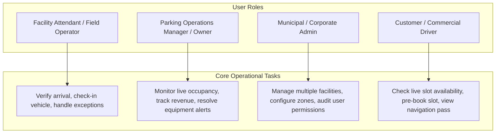
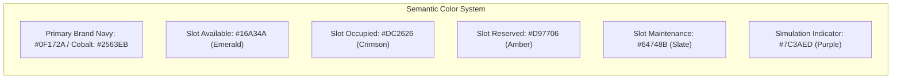
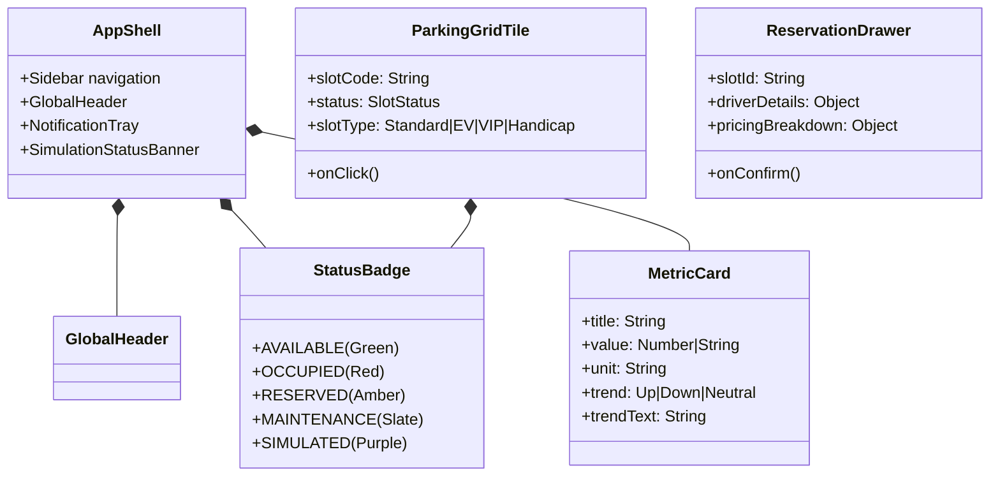

# Google Stitch Design Brief — Smart Parking Operations Platform

> **Milestone:** Frontend Redesign Specification & Stitch Prompt Catalog
> **Status:** Pending Design Approval
> **Target Tool:** Google Stitch (AI-driven UI/UX design generation)
> **Product Working Name:** *[Product Name Pending Selection — see BRAND_NAME_OPTIONS.md]*

---

## 1. Product Positioning & Operational Context

### 1.1 From Hackathon Prototype to Commercial B2B SaaS

The current SmartPark AI application contains valuable foundational architecture: an atomic reservation engine, a PostgreSQL data model, real-time WebSocket fan-out, and edge device tracking. However, its visual presentation reflects a hackathon-era aesthetic: glowing neon borders, faux-terminal elements, sci-fi fonts (`Orbitron`), simulated tickers, and inconsistent theme overrides.

The objective of this design brief is to establish a credible, high-utility, enterprise-grade B2B SaaS design system in **Google Stitch**, ready for direct frontend implementation in React and Tailwind CSS.

### 1.2 Target User Personas & Workflows



1. **Facility Attendant / Gate Operator (Field User):**
   - *Needs:* Rapid visual identification of available slots, 1-click check-in/check-out, clear reservation search by license plate. High contrast, large touch targets, legible in daylight.
2. **Facility Operations Manager / Owner (Desktop User):**
   - *Needs:* Realtime occupancy rate, revenue pacing against targets, instant notification of offline sensors/gate faults, zone rebalancing.
3. **Regional / Municipal Administrator (Multi-Facility User):**
   - *Needs:* High-level multi-facility comparison, fleet statistics, environmental compliance reporting, audit logs.
4. **Driver (Mobile / Public View):**
   - *Needs:* Zero friction, instant slot booking, transparent pricing with tax breakdown, clean confirmation pass with entry QR code.

---

## 2. Proposed Visual Direction & Design System

### 2.1 Theme Recommendation: Crisp Enterprise Light (with Ops Dark Mode Token Support)

We strongly recommend an **Enterprise Clean Light Theme** as the default baseline. Smart parking software is used in facility booths, security guard shacks, and sunlit offices where dark neon interfaces suffer severe glare and illegibility.



### 2.2 Semantic Color Palette

| Token Name | Hex Code | UI Application | Meaning / Connotation |
| :--- | :--- | :--- | :--- |
| `surface-bg` | `#F8FAFC` | App background | Neutral cool canvas, minimizes eye fatigue |
| `surface-card` | `#FFFFFF` | Cards, panels, modals | Clean crisp container with subtle border |
| `surface-subtle`| `#F1F5F9` | Table headers, chip backgrounds | Visual grouping without heavy lines |
| `border-subtle` | `#E2E8F0` | Card borders, dividers | Structural separation (1px solid) |
| `text-primary` | `#0F172A` | Page titles, primary numbers | High-contrast readability (WCAG AAA) |
| `text-secondary`| `#475569` | Field labels, table headings | Clear hierarchy |
| `text-muted` | `#94A3B8` | Timestamps, empty state captions | Secondary metadata |
| `brand-primary` | `#1E40AF` | Navigation active, primary CTAs | Authoritative, professional SaaS blue |
| `brand-accent` | `#3B82F6` | Links, focus rings, highlights | Interactive cue |
| `status-avail` | `#16A34A` | Available slots, success toasts | Unoccupied, ready to book |
| `status-occup` | `#DC2626` | Occupied slots, critical alerts | Active vehicle detected |
| `status-resrv` | `#D97706` | Reserved slots, upcoming bookings | Committed allocation |
| `status-disab` | `#64748B` | Disabled / maintenance slots | Out of service |
| `telemetry-sim` | `#7C3AED` | Simulation tags, synthetic notices | Explicit notice of demo/test mode |

### 2.3 Typography Scale

- **Primary Typeface:** `Inter`, `-apple-system`, `BlinkMacSystemFont`, `Segoe UI`, `Roboto`, `sans-serif`.
  *Eliminates `Orbitron` entirely.* Sci-fi headings look amateur in B2B enterprise procurement.
- **Monospace Typeface:** `JetBrains Mono`, `ui-monospace`, `SFMono-Regular`, `monospace`.
  *Strictly reserved for:* License plate numbers (`MH-02-AB-1234`), slot codes (`A-04`), currency values (`₹1,240.00`), IP addresses, and UUIDs.

| Level | Size / Line Height | Weight | Tracking | Usage |
| :--- | :--- | :--- | :--- | :--- |
| **Display** | 28px / 36px | Semibold (600) | -0.02em | Key metric numbers, KPI totals |
| **Page Title** | 20px / 28px | Semibold (600) | -0.01em | Top header screen titles |
| **Section Header**| 16px / 24px | Semibold (600) | 0 | Card titles, group dividers |
| **Body Default** | 14px / 20px | Regular (400) | 0 | Table text, form labels, tooltips |
| **Caption / Meta**| 12px / 16px | Medium (500) | +0.01em | Status pills, timestamps, helper text |
| **Monospace Large**| 24px / 32px | Bold (700) | 0 | Slot codes, large currency displays |

### 2.4 Data-Density & Layout Principles

1. **Card-Based Structured Grid:** Replace glowing neon floating divs with well-defined 1px bordered cards (`#E2E8F0`) with 8px corner radii (`rounded-lg`) and soft, natural shadows (`shadow-sm`).
2. **Compact Table Rhythms:** Operations tables should default to 40px row height on desktop, providing high information density while retaining comfortable touch targets on mobile/tablet (48px min).
3. **No Decorative Animations:** Eliminate continuous spinning glowing circles and particle confetti. Retain only functional transitions: 150ms hover feedback, smooth 200ms modal fade, and subtle 300ms slot state color transition.

### 2.5 Real vs. Simulated Telemetry Display Rules

To maintain enterprise credibility, the UI must **never deceive the operator**:
- **Live Realtime Data:** Display a solid green pill: `● LIVE (WSS Connected)`.
- **Simulated Test Data:** When the Raspberry Pi simulation loop is running, display an unmistakable purple banner across the screen header:
  > `⚡ SIMULATION MODE ACTIVE — Slot updates are synthetic for demonstration purposes [Stop Simulation]`
- **Stale / Disconnected State:** If the WebSocket connection drops or telemetry hasn't arrived in >30 seconds, display an amber badge: `▲ RECONNECTING — Data may be stale (Last update: 42s ago)`.

---

## 3. Screen-by-Screen Design Specifications

### 3.1 Screen 1: Map Overview & Operations Control (`/dashboard/map`)

*This is the central operating screen of the platform.*

```
+---------------------------------------------------------------------------------------------------------+
| [Header] Phoenix Palladium Mall ▼   [● LIVE]   Search slots, plates...             [Alerts (3)] [Profile]|
+---------------------------------------------------------------------------------------------------------+
| [KPI 1: 120 Total]   [KPI 2: 48 Available]   [KPI 3: 58 Occupied]   [KPI 4: 14 Reserved]                |
+---------------------------------------------------------------------------------------------------------+
| Zone Filter: [All] [Zone A] [Zone B] [Zone C] [VIP] [Handicap]     Status: [All] [🟢] [🔴] [🟡]  [⚙️ Sim]|
+---------------------------------------------------------------------------------------------------------+
| ZONE A — 30 Slots (12 Available, Rate: ₹20/hr)                                                          |
| [ A-01 🟢 ] [ A-02 🔴 ] [ A-03 🔴 ] [ A-04 🟢 ] [ A-05 🟡 ] [ A-06 🟢 ] [ A-07 🔴 ] [ A-08 🟢 ] ...      |
|                                                                                                         |
| ZONE B (EV Enabled) — 30 Slots (8 Available, Rate: ₹20/hr)                                              |
| [ B-01 ⚡🟢 ] [ B-02 ⚡🔴 ] [ B-03 🟢 ] [ B-04 🔴 ] [ B-05 🟢 ] ...                                      |
|                                                                                                         |
| VIP ZONE — 20 Slots (6 Available, Rate: ₹50/hr)                                                         |
| [ V-01 ⭐🟢 ] [ V-02 ⭐🔴 ] [ V-03 ⭐🟡 ] ...                                                             |
+---------------------------------------------------------------------------------------------------------+
```

- **Primary Persona:** Facility Attendant & Operations Manager.
- **Key Regions:**
  - **Top Bar:** Facility selector dropdown with address, live WebSocket connection heartbeat, search bar for instant slot or driver lookup.
  - **KPI Header:** 4 clean metric cards with bold numbers and trend arrows.
  - **Filter Toolbar:** Zone chips with slot counts, status toggles, auto-refresh interval switch (5s/10s/Off), and simulation drawer toggle.
  - **Parking Grid:** Grouped by zone with clear lane/row demarcations.
- **Slot Tile Interaction:**
  - Available (`🟢`): Hover shows rate and slot type. Clicking opens the **Booking Drawer**.
  - Occupied (`🔴`): Hover shows vehicle number and elapsed parking duration. Clicking opens the **Occupant Inspection Card**.
  - Reserved (`🟡`): Hover shows reservation code and reserved driver name.
  - Disabled (`✕`): Greyscale with maintenance badge.
- **Booking Drawer (Slide-Over from Right):**
  - Clean form replacing the heavy modal.
  - Fields: Driver Full Name, Phone (`+91` formatted), Vehicle Number (auto-uppercase), Duration slider (1h–12h), Payment Method pills (UPI, Card, Cash).
  - Clear itemized pricing breakdown: Base Rate + Platform Fee (10%) + GST (18%) = Total Amount.
  - "Confirm Reservation" button with inline loader.
  - Upon booking: Shows a **real SVG-rendered QR code pass** with reservation code and a 1-click "Print Gate Ticket" action.

---

### 3.2 Screen 2: Reservations & Dispatch Center (`/dashboard/reservations`)

- **Primary Persona:** Front-desk Attendant & Facility Supervisor.
- **Key Regions:**
  - **Summary Bar:** Total Active Today, Upcoming Bookings, Completed, Cancelled.
  - **Search & Filter Bar:** Instant filter by Plate Number, Driver Name, or Reservation Code (`SPK-XXXX`). Status filter tabs.
  - **Data Table:**
    - Columns: Reservation Code (`font-mono`), Driver Name & Contact, Vehicle Number, Slot & Zone, Scheduled Window (Start–End), Duration, Payment Method & Total Amount, Status Pill, Contextual Action.
  - **Contextual Actions:**
    - `UPCOMING`: "Check-in" button (one click moves slot to OCCUPIED and reservation to ACTIVE), "Cancel" button.
    - `ACTIVE`: "Check-out" button (one click marks COMPLETED and frees slot to AVAILABLE).
  - **Drawer / Inspector:** Clicking any row opens an audit drawer showing full payment timestamp, driver details, and facility address.

---

### 3.3 Screen 3: Occupancy & Operations Analytics (`/dashboard/analytics`)

- **Primary Persona:** Facility Owner, Commercial Real Estate Asset Manager.
- **Key Regions:**
  - **Top KPI Cards:** Occupancy Rate (%) with benchmark comparison, Peak Hour Window, Average Dwell Time (hours), Total Guided Vehicles.
  - **Primary Chart (24-Hour Occupancy Curve):**
    - High-legibility area chart comparing Today's Live Occupancy against the 7-day rolling average.
    - Explicit visual markers for Peak Demand periods.
  - **Zone Utilization Breakdown:** Clean horizontal bar chart comparing Zone A, B, C, VIP, and Handicap capacity utilization.
  - **Top Performing Slots Table:** Sortable table displaying slot code, total reservations, gross revenue generated, and active status.
  - **Rule-Based Operational Recommendations:** Clean structured insights cards (e.g. *"Zone B reached 92% utilization between 18:00 and 20:00 — Consider dynamic surge pricing"*).

---

### 3.4 Screen 4: Revenue & Financial Reconciliation (`/dashboard/revenue`)

- **Primary Persona:** Finance Controller, Parking Facility Owner.
- **Key Regions:**
  - **Financial Summary Cards:** Gross Revenue Today, Net Revenue MTD, Average Revenue Per Slot Day (RevPAS), Settled vs. Pending Payouts.
  - **Daily Revenue Trend:** Composed chart with daily stacked bars (Base Parking, Reservations, Overstay Penalties) overlaid with a 7-day moving average trend line.
  - **Payment Gateway Split:** Clean donut chart showing UPI vs. Credit/Debit Card vs. Cash distribution.
  - **7x24 Demand Heatmap:** Matrix displaying hours of the day (0–23) across days of the week (Mon–Sun), shaded with monochromatic saturation representing transaction density.
  - **Rate Configuration Table:** Dedicated table showing each Zone, Current Base Hourly Rate, and Editable Overstay Rate.

---

### 3.5 Screen 5: Edge Device Health & Operational Alerts (`/dashboard/alerts` & `/dashboard/admin`)

- **Primary Persona:** Field Operations Engineer, System Administrator.
- **Key Regions:**
  - **Critical Alert Ticker:** High-priority banner for active camera or sensor outages.
  - **Live Alert Feed (Connected to DB `Alert` entity):**
    - Cards categorized by Severity (`CRITICAL`, `WARNING`, `INFO`).
    - Title, facility zone, elapsed time since trigger.
    - "Resolve Incident" button with immediate database update.
  - **Hardware Gateway Fleet Table:**
    - Device Code (`RAPI-01`), Bound Zone, IP Address, Online/Offline Pulse Badge, CPU Utilization Bar, Memory Usage Bar, Core Temperature (°C with color thresholds: green <65°C, amber 65–75°C, red >75°C), Last Ping Timestamp.
  - **Device Configuration Modal:** Register new Raspberry Pi / camera device with assigned zone.

---

### 3.6 Screen 6: Environmental Impact & City Dashboard (`/dashboard/environment`)

- **Primary Persona:** City Smart Mobility Officer, Corporate Sustainability Auditor.
- **Key Regions:**
  - **Headline Environmental KPIs:**
    - Liters of Fuel Saved (calculated transparently: `0.2L × Completed Guided Parkings`).
    - Metric Tons of CO₂ Abated (`2.31 kg CO₂ / L`).
    - Cumulative Citizen Search Hours Saved (`14.3 min / parking`).
    - Tree Equivalent Absorption Index (`CO₂ / 21.7 kg`).
  - **Transparent Methodology Card:** Clean formula callout showing exactly how ESG figures are derived, maintaining strict regulatory credibility.
  - **Verified Audit Report Generator:** Legitimate "Export ESG Summary" action downloading formatted PDF/CSV data.

---

### 3.7 Screen 7: Secure Authentication & Role Selection (`/login`)

- **Primary Persona:** All returning users.
- **Key Regions:**
  - High-trust, distraction-free card centered on a clean slate background.
  - Enterprise brand logo, clear product title and tagline.
  - Email and Password inputs with floating labels and password visibility toggle.
  - Quick Role Selector (for demo/development environments) clearly labeled:
    `[Quick Demo Fill: Driver | Owner | Admin]`.
  - Secure login CTA button with stateful loading indicator.
  - Subtle footer displaying system release version (`v1.2.0`) and SSL/compliance badge.

---

## 4. Reusable Component Inventory



1. **Global Header:**
   - Left: Mobile hamburger trigger, Facility selector dropdown, current breadcrumb trail.
   - Center: Global search input (`Ctrl + K` shortcut) capable of finding slots, vehicle plates, and routes.
   - Right: Realtime status pill (`● Connected`), Unread Alert Bell with popover drawer, User Avatar with role chip and dropdown menu (Profile, Facility Settings, Logout).
2. **Global Sidebar:**
   - Top: New commercial logo mark and platform name.
   - Navigation Items: Clean icons with active indicator bars and role-filtered visibility.
   - Bottom: Compact current facility indicator and operator sign-out CTA.
3. **Interactive Parking Slot Component:**
   - Aspect ratio 1:1 square with rounded corners.
   - Bold monospace slot code centered.
   - Status color-coded border (2px) and light tinted fill.
   - Compact iconography for EV charging (`⚡`), VIP (`★`), or Handicap (`♿`).
4. **Data Table Pattern:**
   - Sticky header with sortable column indicators (`↑ / ↓`).
   - Monospace typography for numbers, dates, and identifiers.
   - Pinned actions column on the right.
   - Unified pagination bar showing record range and page controls.

---

## 5. Ready-to-Use Google Stitch Prompts

Use these prompts directly in **Google Stitch** to generate cohesive, professional UI designs for the platform.

### Prompt 1: Master Application Shell & Design System
```text
Design a responsive, enterprise-grade B2B SaaS application shell for an intelligent parking operations platform.

Visual Style:
- Professional, high-contrast light theme with an off-white background (#F8FAFC) and crisp white cards (#FFFFFF) with subtle 1px slate borders (#E2E8F0) and soft shadows (0 1px 3px rgba(0,0,0,0.05)).
- Primary brand accent is deep corporate cobalt (#1E40AF), with interactive blue (#3B82F6).
- Typography uses Inter for all headings and body text, and clean tabular monospace (JetBrains Mono) strictly for numbers, license plates, slot codes, and currencies.
- Absolutely NO glowing neon borders, NO futuristic sci-fi fonts, and NO gratuitous dark glassmorphism. It must look like an enterprise operational dashboard for commercial real estate and smart cities (similar to Stripe Dashboard, Datadog, or Linear).

Layout Structure:
1. Fixed Left Sidebar (256px width):
   - Top: Brand logo with bold typography and a subtle "Enterprise" badge.
   - Main Navigation: Clean vertical list with modern outline icons: Live Map, Reservations, Analytics, Revenue, Device Health & Alerts, ESG Impact, Settings. Active state has a subtle blue tint background (#EFF6FF) and a solid blue left indicator bar.
   - Bottom: Logged-in user profile pill with initials avatar, name, uppercase role chip ("OPERATOR"), and a subtle sign-out button.
2. Sticky Top Header (64px height):
   - Facility Selector dropdown showing current facility ("Phoenix Palladium Mall — Mumbai") with a location pin icon.
   - Global search bar with shortcut hint "Ctrl + K", searching slots, vehicle numbers, and reservations.
   - Right side controls: Live WebSocket connection pill ("● Live"), Alert notification bell with unread badge count (3), and current live clock in 24h format.
3. Main Content Area:
   - Dynamic canvas with 24px padding, structured with clean KPI metric cards at the top and flexible responsive grid below.
```

### Prompt 2: Live Parking Map & Realtime Operations Grid (Central Screen)
```text
Design the central "Live Parking Map & Operations Overview" screen for a commercial smart parking platform, hosted within the enterprise SaaS shell.

Layout & Hierarchy:
1. Screen Header:
   - Page title "Live Operations & Slot Map", subtitle "Realtime bay occupancy and dispatch control".
   - Facility overview metrics bar with 4 KPI cards:
     * Total Capacity: "120 Bays" (Neutral)
     * Available: "48 Bays" (Emerald green text #16A34A with subtle green tag)
     * Occupied: "58 Bays" (Crimson red text #DC2626 with subtle red tag)
     * Reserved: "14 Bays" (Warm amber text #D97706 with subtle amber tag)
2. Filter & Action Toolbar:
   - Zone selection segmented buttons: "All Zones (120)", "Zone A (30)", "Zone B - EV (30)", "Zone C (30)", "VIP Lounge (20)", "Accessible (10)".
   - Status filters: Multi-select pills for Available, Occupied, Reserved, Maintenance.
   - Right controls: Auto-refresh toggle switch (Active, 5s), Manual refresh button, and "Simulate Traffic" slide-over toggle button with a distinct purple test badge.
3. Parking Grid Visualization:
   - Grouped into organized zone sections with clear aisle dividing headers.
   - Each slot is represented as an interactive square bay card (aspect ratio 1:1, ~72px size):
     * Available bay: Crisp white background, 2px emerald green border (#16A34A), centered bold slot code "A-04", hover shows "+ Reserve".
     * Occupied bay: Light red tinted background, 2px red border (#DC2626), slot code and a small minimalist car icon with duration tag "1h 14m".
     * Reserved bay: Light amber background, amber border (#D97706), slot code with driver initial badge.
     * EV bay: Includes a small electric bolt icon badge in the corner.
4. Booking Slide-Over Drawer (Opened when clicking an Available Bay):
   - Sleek right-side panel (420px width) titled "Quick Reserve — Bay A-04".
   - Form fields: Driver Name, Phone Number with "+91" prefix, Vehicle Registration Plate (styled like a realistic registration plate), Parking Duration slider (1h to 8h with real-time rate calculation).
   - Transparent price calculation box: Base Rate (₹20 × 3h = ₹60.00) + Service Fee (₹6.00) + GST 18% (₹11.88) = Total ₹77.88.
   - Payment method selector: UPI (Default), Card, Cash.
   - Primary Action button: "Confirm Reservation & Generate Gate Pass".
```

### Prompt 3: Reservations & Dispatch Management Screen
```text
Design the "Reservations & Booking Dispatch" management table screen for the parking operations SaaS.

Layout & Features:
1. Metrics Row:
   - 4 compact stat cards: Active Parkings (58), Expected Arrivals (14), Completed Today (142), Cancellations (3).
2. Filter Toolbar:
   - Full-width search bar: "Search by booking code (e.g. SPK-1042), vehicle number, or driver phone".
   - Tabbed status filter: "All Bookings", "Upcoming", "Active / In-Facility", "Completed", "Cancelled".
   - Date range picker dropdown ("Today: Oct 15, 2026").
3. High-Density Operational Data Table:
   - Clean tabular layout with crisp dividing lines (#E2E8F0) and subtle zebra striping on hover.
   - Columns:
     * Code: Monospace chip (e.g. "SPK-4912")
     * Driver Details: Primary text driver name ("Vikram Joshi"), secondary muted phone ("+91 98200-11234")
     * Vehicle Plate: Monospace high-contrast badge ("MH-02-CD-4120")
     * Bay & Zone: "Bay B-08" with secondary zone tag ("Zone B • EV")
     * Time Window: Scheduled entry & exit ("14:00 – 17:00")
     * Total Billed: Monospace currency ("₹120.00")
     * Status Badge: Pill badge (Upcoming = Blue, Active = Green, Completed = Slate, Cancelled = Red)
     * Actions: Action buttons directly in the row:
       - For Upcoming bookings: Green "Check-in" button and subtle "Cancel" link.
       - For Active bookings: Amber "Check-out" button.
4. Reservation Detail Inspector:
   - Clicking a row highlights the row and slides open an audit drawer showing ticket breakdown, payment method (UPI reference ID), and a printable driver entry QR code pass.
```

### Prompt 4: Occupancy & Revenue Analytics Dashboard
```text
Design the "Executive Analytics & Financial Performance" dashboard for parking asset managers.

Layout & Visual Elements:
1. Top KPI Summary:
   - Gross Revenue Today: "₹24,850.00" with "+14.2% vs last Thursday" green trend indicator.
   - Occupancy Rate: "78.4%" with mini radial progress indicator.
   - RevPAS (Revenue Per Available Slot): "₹207.08 / bay / day".
   - Average Parking Duration: "2.4 Hours".
2. 24-Hour Occupancy Demand Chart:
   - Large interactive area chart (height 320px) showing occupancy % across 24 hours.
   - Dark blue fill curve with a highlighted peak demand zone (17:00 to 20:00).
   - Dotted reference line showing facility target capacity threshold (85%).
3. Weekly Revenue Trend & Payment Breakdown (2-Column Grid):
   - Left: Stacked bar chart showing Daily Revenue for the past 7 days, broken down by Hourly Parking vs. Advance Reservations, with a 7-day moving average overlay line.
   - Right: Donut chart showing Payment Method Distribution (UPI 64%, Credit Card 24%, Cash 8%, Corporate Fleet 4%).
4. Top Performing Parking Bays Table:
   - Ranked list of top 10 most profitable parking slots with slot code, zone, utilization percentage, total turnover count, and revenue generated.
5. Automated Revenue Insights:
   - Clean alert cards with actionable operational suggestions (e.g., "Zone A reaches 95% occupancy on weekend evenings — Recommended surge rate: ₹35/hr").
```

### Prompt 5: Edge Device Monitoring & System Incident Alerts
```text
Design the "IoT Edge Infrastructure & System Health" monitoring screen for parking hardware operators.

Layout & Structure:
1. Infrastructure Status Header:
   - System Health Cards:
     * Edge Gateways: "4 Devices Online (1 Offline)"
     * Sensor Ping Latency: "34ms Average"
     * Active Alarms: "2 Unresolved Incidents"
2. Active Incident Alert Queue:
   - High-visibility cards with severity badges:
     * CRITICAL (Red): "Zone B Entrance Camera Gateway (RAPI-03) Unreachable — Offline for 12 minutes". Includes "Acknowledge" and "Mark Resolved" action buttons.
     * WARNING (Amber): "Zone A Thermal Warning — Gateway RAPI-02 CPU Temp at 74°C".
     * INFO (Blue): "Automated telemetry database backup completed successfully".
3. Device Fleet Health Table:
   - Table displaying edge hardware units (Raspberry Pi & camera gateways):
     * Device ID: Monospace code ("RAPI-01", "RAPI-02")
     * Assigned Zone: "Zone A North Entrance"
     * Status: Green pulsing dot with "ONLINE", Amber "MAINTENANCE", or Red "OFFLINE"
     * IP Address: Tabular monospace ("192.168.1.42")
     * CPU Load: Compact progress bar with percentage ("34%")
     * RAM Load: Compact progress bar ("62%")
     * Operating Temp: Temperature gauge with color warning ("52°C")
     * Last Heartbeat: "12s ago"
     * Actions: "Reboot Gateway" and "View Telemetry Logs" buttons.
```

### Prompt 6: Modern Commercial Login & Authentication Screen
```text
Design a clean, professional, high-trust B2B login screen for the Smart Parking Operations platform.

Visual Direction:
- Clean, minimal slate background (#F8FAFC) with subtle ambient geometric grid pattern.
- Centered authentication card (440px width) in pure white (#FFFFFF) with a 1px border (#E2E8F0) and deep soft shadow.
- Header: Bold corporate logo with product name and tagline "Commercial Smart Parking & Mobility Operations Platform".

Card Contents:
1. Title: "Sign in to your facility account", subtitle "Enter your work credentials to access the dispatch portal".
2. Form Fields:
   - Work Email: Clean input with mail icon and clear validation state.
   - Password: Input with lock icon, "Forgot password?" link aligned to the right, and show/hide password toggle.
   - Remember this workstation checkbox.
3. Sign In Button:
   - Full-width deep blue primary button (#1E40AF) with hover elevation.
4. Demo Environment Quick-Fill Bar (Special section for testing & evaluation):
   - Subtle separated panel with title "Evaluation Demo Credentials":
   - 3 one-click role buttons that prefill credentials:
     * "Attendant / Driver" (`driver@smartpark.ai`)
     * "Facility Owner" (`owner@smartpark.ai`)
     * "City Admin" (`admin@smartpark.ai`)
5. Footer:
   - Subtle security notice: "SOC-2 Type II Certified • 256-bit SSL Encrypted • System Status: Operational".
```
